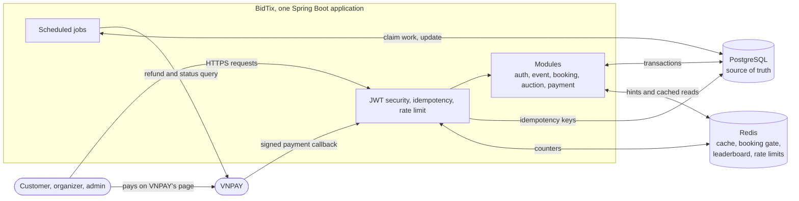
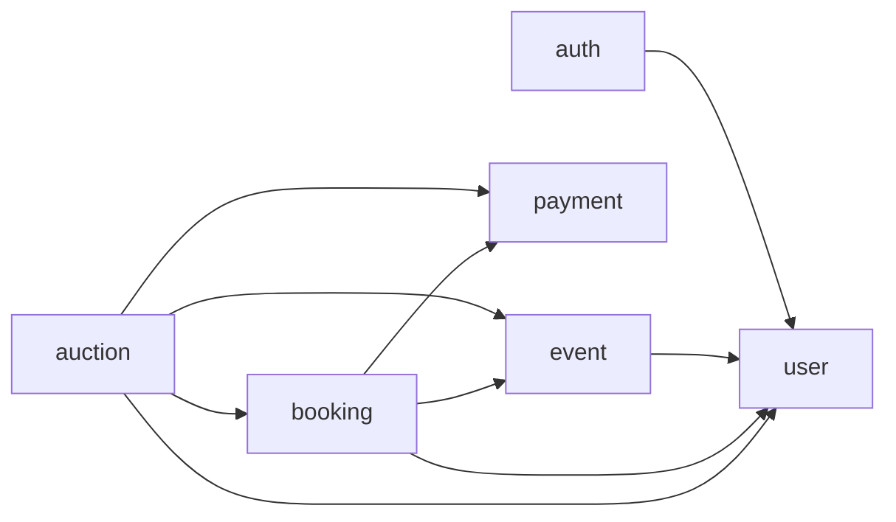
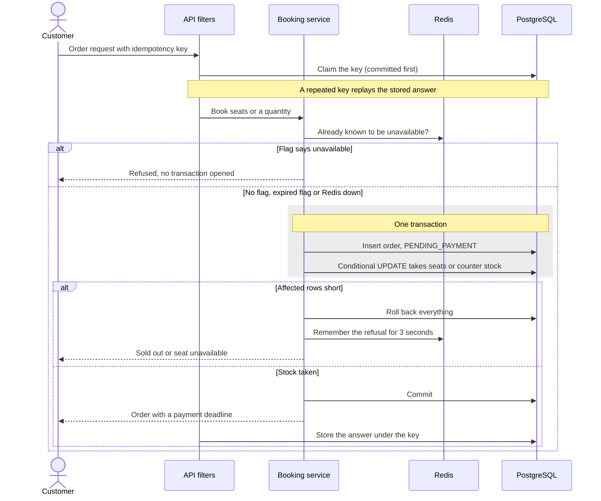
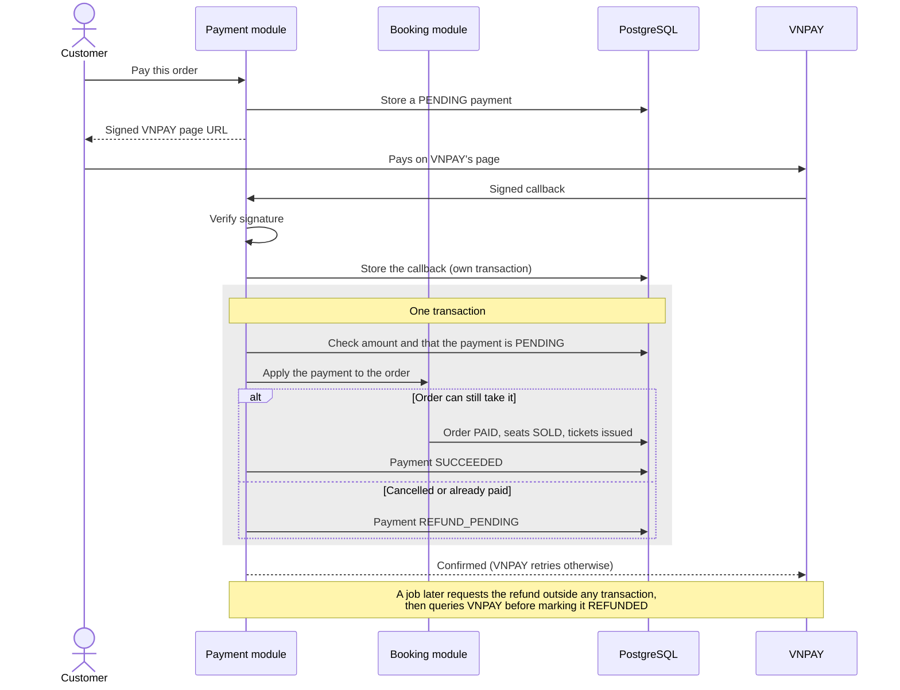
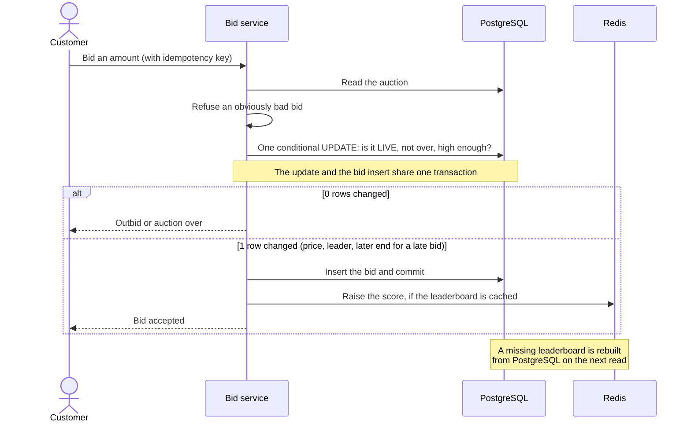
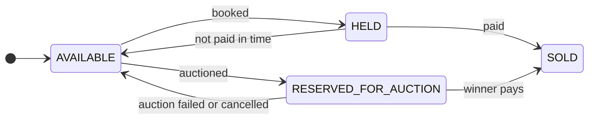
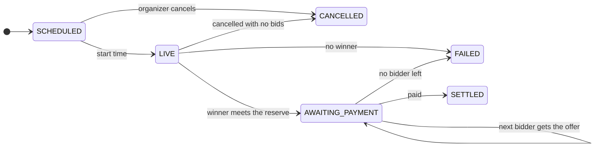
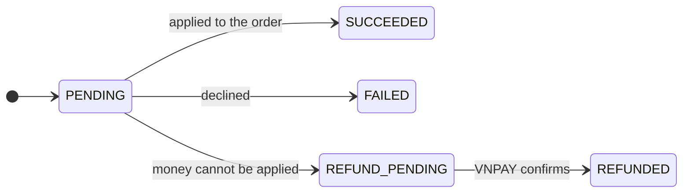
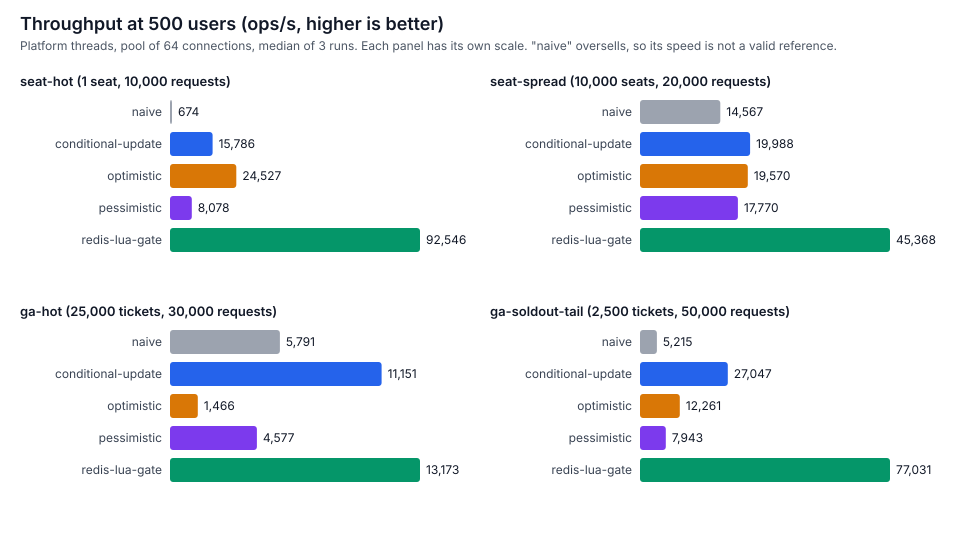

<p align="center">
  
</p>

<p align="center">
  <a href="https://github.com/tqha1011/BidTix/actions/workflows/ci.yml"></a>
  
  
  
  
  
  
  <a href="LICENSE"></a>
</p>

# BidTix

A concert ticketing backend with two ways to buy a ticket: **fixed-price booking** (numbered seats and standing
zones) and **English auctions** for premium tickets.

The goal is to get the hard backend problems right rather than to build a long feature list: no overselling, no
double-sold seats, no lost bids, safe client retries, short and correct transactions, and caching that never decides
who gets a ticket.

**Contents:** [Project summary](#project-summary) · [Architecture](#architecture) · [Data flows](#data-flows) ·
[Engineering decisions](#engineering-decisions) · [Measured results](#measured-results) · [Testing](#testing) ·
[Getting started](#getting-started) · [Limitations and roadmap](#limitations-and-roadmap) ·
[Documentation](#documentation)

## Project summary

The facts about this project in one place, for a portfolio, a CV or a quick review.

| | |
|---|---|
| **Name** | BidTix |
| **One line** | A concert ticketing backend (fixed-price booking and live auctions) built to stay correct under heavy concurrency |
| **Type** | Personal portfolio project, backend only |
| **Author** | Tran Quang Ha ([@tqha1011](https://github.com/tqha1011)) |
| **Period** | Started November 2026, still in progress |
| **Stack** | Java 21, Spring Boot 4 (Web MVC, Data JPA, Security), PostgreSQL, Flyway, Redis, VNPAY, JUnit 5, Testcontainers, k6, Docker, GitHub Actions |
| **Architecture** | Modular monolith, package-by-feature, layered inside each module |
| **Evidence** | 481 automated tests (at commit `f8bd6b8`), reproducible [benchmarks](docs/benchmarks.md), [load test log](docs/load-test-log.md), 5 [architecture decision records](docs/ADR) |

**The problem.** When a popular concert goes on sale, thousands of requests compete for the same seats within seconds,
clients retry, payment results arrive late or twice, and unpaid orders must give their stock back. Each of these can
sell a ticket twice, lose money or lock inventory for good.

**What was built.** Registration and login with rotating refresh tokens, venue and event management, booking of seated
and standing tickets, English auctions with anti-sniping and second-chance offers, VNPAY payments and a refund job,
all on one PostgreSQL database with Redis used only where losing it cannot break correctness.

**Highlights**

- **No overselling:** stock is taken by one conditional `UPDATE` whose affected-row count is checked, backed by database
  constraints. In the benchmark, naive read-then-write oversold in every scenario and the chosen approach never did.
- **Chosen by measurement:** five concurrency strategies were compared at 500 simulated users. On a contended counter
  the conditional update handled about 7.6 times more operations per second than optimistic locking, which also turned
  away 35% of requests while tickets remained.
- **Fast refusals:** a short-lived Redis flag rejects requests already known to fail. On the booking flow in a sell-out
  scenario it raised throughput 2.4 times and cut median latency from 479 ms to 4.6 ms.
- **Payments that survive bad timing:** signed callbacks are stored, applied exactly once, and marked for refund when
  the order can no longer take the money.
- **Safe with several instances:** background jobs claim their rows with `FOR UPDATE SKIP LOCKED`.
- **Load tested end to end:** in a 30-minute simulated sale (259,006 requests) all 15 data integrity checks passed.

**Skills shown:** concurrency control and transaction design, PostgreSQL locking and constraints, idempotent APIs,
payment gateway integration, caching and rate limiting with Redis, JWT authentication, integration and concurrency
testing, benchmarking and load testing, writing architecture decision records.

**Scope of these claims.** Payments run against VNPAY's sandbox only, and refunds are not proven there yet. All
performance figures come from simulated traffic on one laptop. There is no web or mobile client. Cancelling an event,
the per-user ticket limit and ticket check-in are not built. See [Limitations and roadmap](#limitations-and-roadmap).

## Architecture

BidTix is a **modular monolith**: one deployable Spring Boot application and one PostgreSQL database, split into
business modules by feature.



- **Layers in a module:** `controller` (HTTP and DTOs) → `service` (business rules and transactions) →
  `infrastructure` (Spring Data repositories, Redis, external clients), with `domain` holding entities.
- **PostgreSQL decides.** Redis holds only data that can be lost or stale: a missing key means a slower answer or a
  database check, never a ticket sold twice.
- **One error format:** RFC 9457 `ProblemDetail` with a stable error code, including errors raised inside security
  filters.

Dependencies between the business modules go one way (an arrow means "uses"):



Why a monolith: inventory, locking and transactions are easiest to get right, and to test, with one transactional
database. Entities in different modules refer to each other by id only, which keeps a later split possible without
paying for distributed transactions now.

## Data flows

### Booking: taking the stock

Booking only reserves. The ticket is issued after payment.



### Payment: from redirect to ticket

Only VNPAY's server-to-server callback records a payment. The page the browser returns to is read-only.



For an auction order, the same transaction also accepts the offer and settles the auction.

### Auction: placing a bid



### Background jobs

| Job | Runs | What it moves |
|---|---|---|
| Auction activation | every 5 s | `SCHEDULED` auctions whose start time passed become `LIVE` |
| Auction closing | every minute | ended auctions go to the winner, or fail and release the ticket |
| Offer expiry | every minute | an unpaid offer passes to the next bidder, at that bidder's own bid |
| Unpaid order cancellation | every minute | expired booking orders are cancelled and their stock returns, 100 per transaction |
| Refunds | every minute | requests refunds from VNPAY and confirms their outcome |

Every job claims rows with `FOR UPDATE SKIP LOCKED`, so several application instances can run them. An expired order
or offer with a payment still unconfirmed is kept 10 minutes longer, so a late callback does not punish a customer who
paid in time.

### Lifecycles

**Seat**



**Order:** `PENDING_PAYMENT` → `PAID`, or `CANCELLED` when the deadline passes.

**Auction**



**Payment**



## Engineering decisions

| Problem | Decision | Proven by |
|---|---|---|
| Two people buy the last seat | Conditional `UPDATE` on `AVAILABLE` seats with a row-count check; a partial unique index on active tickets as the last line of defence ([ADR-0001](docs/ADR/0001-hold-seats-with-a-conditional-update.md)) | 30 users race for one seat: one wins. 60 users over 10 seats: no double sale, no deadlock |
| Overselling standing tickets | Atomic decrement guarded by "enough left", plus a `CHECK` constraint on the counter ([ADR-0003](docs/ADR/0003-take-general-admission-stock-with-a-conditional-update.md)) | 60 users over 20 tickets: never oversold, no lost update |
| Concurrent bids | One conditional `UPDATE` decides status, deadline and minimum price; unique amount per auction | 12 parallel bids: the highest leads. Same amount: one accepted |
| Payment results arrive late, twice or for a dead order | Reserve first, apply on the signed callback, guard with the payment's status ([ADR-0005](docs/ADR/0005-confirm-vnpay-payments-in-the-ipn-callback.md)) | 8 identical callbacks in parallel: paid once |
| A refund request that may or may not have arrived | Commit a claim before calling; release it only when the request certainly never left | Tested against a local stand-in, not proven on the sandbox |
| Clients retry requests | Idempotency key and request hash for orders, bids and payments; the stored answer is replayed | 10 identical requests at once: runs once |
| Most requests lose once an event sells out | Redis flag that can only refuse, never grant; fails open ([ADR-0004](docs/ADR/0004-refuse-known-sold-out-requests-with-a-redis-flag.md)) | Benchmarked on and off |
| Unpaid orders keep stock locked | Batched cancellation with `SKIP LOCKED`; a failing batch is retried order by order | Several jobs at once give each order back once |
| Many requests miss the cache together | Cache-aside with TTLs, evicted on write, with a locking cache writer | 16 simultaneous misses: one database load |
| Stolen refresh token | Rotation with reuse detection; only token hashes are stored | Reuse revokes all of that user's sessions |
| Abuse and floods | Redis rate limits: fixed window for login and registration (fail-closed), token bucket per user | Parallel requests: exactly the limit gets through |

## Measured results

Full method, raw numbers and caveats are in [`docs/benchmarks.md`](docs/benchmarks.md). Everything ran on one machine,
so compare the figures with each other rather than reading them as production capacity.

**Concurrency strategies** (inventory step only, 500 simulated users, one hot standing-ticket counter, 30,000 requests)

| Strategy | Operations/s | Oversold tickets |
|---|--:|--:|
| Naive read-then-write | 5,791 | 73,593 |
| Redis Lua gate, then database | 13,173 | 0 |
| **Conditional `UPDATE`** (used) | **11,151** | **0** |
| Pessimistic lock | 4,577 | 0 |
| Optimistic lock | 1,466 (35% gave up with stock left) | 0 |



**Booking gate on the booking flow** (500 users, connection pool of 10, payment mocked)

| Scenario | Gate off | Gate on |
|---|--:|--:|
| Selling out, operations/s | 969 | 2,301 |
| Selling out, median latency | 479 ms | 4.6 ms |
| Plentiful stock, operations/s | 757 | 717 (no gain) |

**Cancelling unpaid orders:** 100 orders per transaction was 20 to 35 times faster than one per transaction.

**Load test over HTTP** (k6; application and PostgreSQL limited to 2 CPUs each)

| Measure | Result |
|---|---|
| 90% reads, 10% bookings, held for 180 s | 600 requests/s, p95 11 ms (highest rate tried that passed) |
| 70% reads, 30% bookings, highest rate | about 500 to 590 requests/s |
| Requests open at once with p95 under 500 ms | about 75 |
| Requests open at once without a failure | 3,200, each waiting about 6 s |
| Breaking point | between 3,200 and 6,400 open requests |

A just-started instance carries much less until the JVM has warmed up.

**Sale day** (30 minutes, up to 1,000 shoppers and 150 bidders, 259,006 requests, one run): p95 was 7 to 24 ms in the
waiting, rush and long-tail phases and 380 ms in the minute the sale opened. The 41 failed requests all came in the
first minute after start-up, and all 15 data checks passed.

## Testing

Integration tests run the whole application against real PostgreSQL and Redis containers (Testcontainers), with Flyway
building the schema. Where concurrency matters they start many requests at the same instant and assert what must stay
true: no seat sold twice, counters equal to tickets taken, the highest bid leading, one payment applied, and each job
item processed once. VNPAY is replaced by self-signed callbacks and a local stand-in for its refund and query API.
GitHub Actions runs the suite on every pull request into `main` and every push to it.

```bash
./mvnw test                                       # everything (Docker must be running)
./mvnw test -Dtest=BidConcurrencyTest             # one class

make bench                                        # compare the anti-overselling strategies
make bench-gate                                   # booking gate on and off
make bench-cancel                                 # transaction size when cancelling orders
make load-test                                    # load test over HTTP with k6
make sale-day                                     # 30 simulated minutes, then data checks
```

## Getting started

Requirements: JDK 21 and Docker. Spring Boot starts PostgreSQL and Redis from `compose.yaml` automatically.

```bash
make run-local      # creates the JWT signing keys if needed, then starts the app
make run-seed       # same, and fills an empty database with sample data (dev only)
make help           # all other commands
```

Without `make`:

```bash
mkdir -p keys
openssl genpkey -algorithm RSA -pkeyopt rsa_keygen_bits:2048 -out keys/private.pem
openssl pkey -in keys/private.pem -pubout -out keys/public.pem
# the refresh cookie is "Secure": switch that off only for plain-http local testing
BIDTIX_AUTH_REFRESHCOOKIE_SECURE=false ./mvnw spring-boot:run
```

The API reference is generated from the code: <http://localhost:8080/swagger-ui/index.html>.

**Sample data** creates `admin@bidtix.dev`, `organizer@bidtix.dev` and `customer1..3@bidtix.dev` (password
`Password123!`), venues, published events and paid tickets. Never enable it in production.

**Payments** need `VNP_TMNCODE` and `VNP_HASH_SECRET` from a VNPAY sandbox account as environment variables (the app
does not read `.env` by itself). VNPAY must be able to reach the callback URL over public HTTPS, so local testing
needs a tunnel. Setting `bidtix.payment.refund-cron` to `-` turns the refund jobs off.

## Limitations and roadmap

Known limits:

- Refunds have not been seen to work on the VNPAY sandbox, and nothing reconciles payments left pending.
- An idempotency key is stored outside the business transaction: a crash between the two lets the same request run
  once more after a timeout.
- This is not hexagonal architecture: entities are JPA entities and services call repositories directly. Module
  boundaries are a convention that no test enforces.
- Only customers can register; organizer and admin accounts come from the seed or from SQL.

Done:

- [x] Authentication with rotating refresh tokens, roles, one error format
- [x] Venues, events, zones and seats
- [x] Booking of seats and standing tickets, cancellation of unpaid orders
- [x] Auctions: bidding, anti-sniping, closing, second-chance offers, leaderboard
- [x] VNPAY payments, idempotent callback, grace period, refund job
- [x] Idempotency keys, Redis cache, rate limits, booking gate
- [x] Concurrency tests, benchmarks and load tests

Next:

- [ ] Cancelling an event (only the skeletons of its clean-up jobs exist)
- [ ] Refunds proven on the VNPAY sandbox
- [ ] Per-user ticket limit and ticket check-in
- [ ] Observability: a secured Prometheus endpoint

## Documentation

- [`docs/database-schema.md`](docs/database-schema.md): tables, constraints and the concurrency strategy
- [`docs/ADR/`](docs/ADR): architecture decision records
  - [ADR-0001](docs/ADR/0001-hold-seats-with-a-conditional-update.md): hold seats with a conditional UPDATE
  - [ADR-0002](docs/ADR/0002-take-payment-outside-the-transaction.md): take payment outside the transaction (superseded by ADR-0005)
  - [ADR-0003](docs/ADR/0003-take-general-admission-stock-with-a-conditional-update.md): take standing-zone stock with a conditional UPDATE
  - [ADR-0004](docs/ADR/0004-refuse-known-sold-out-requests-with-a-redis-flag.md): refuse known sold-out requests with a short-lived Redis flag
  - [ADR-0005](docs/ADR/0005-confirm-vnpay-payments-in-the-ipn-callback.md): confirm VNPAY payments in the IPN callback
- [`docs/benchmarks.md`](docs/benchmarks.md): benchmarks and load tests, with method and caveats
- [`docs/load-test-log.md`](docs/load-test-log.md): every load test run with its raw results
- [`CLAUDE.md`](CLAUDE.md): conventions and rules for working in this repository

## License

MIT, see [`LICENSE`](LICENSE).
