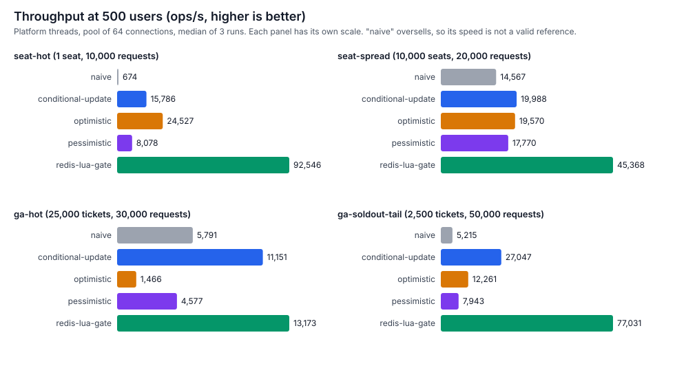
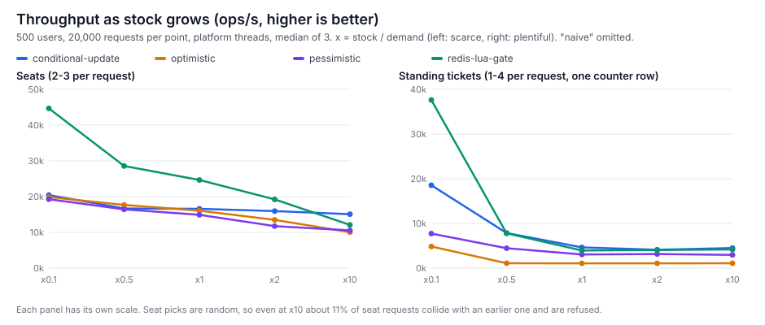

# Anti-overselling benchmark

Compares five ways of making sure a seat or a standing ticket is sold only once, under concurrent load, on a
real PostgreSQL (Testcontainers). The question is not only "is it correct" (the other concurrency tests answer
that) but "what does correctness cost": throughput, tail latency, retries, false rejections.

## Run it

```bash
make test                       # fast: also runs the benchmark's own self-tests (no benchmark)
make bench                      # the full matrix, slow; needs Docker
make bench ONLY=optimistic      # only strategies whose name contains the text
make bench RUNS=3               # measured runs per cell (default 5, plus one discarded warm-up)
make bench THREADS=500          # simulated users, comma list (default 8,32,64)
make bench SCALE=5              # multiply requests and inventory (see below)
make bench VIRTUAL=true         # run the simulated users on Java 21 virtual threads instead of platform threads
make bench RATIOS=0.1,0.5,1,2,10 REQUESTS=20000   # the stock sweep instead of the four fixed scenarios (see below)
```

The table is printed and also written to `target/benchmark/results-platform.md` (or `results-virtual.md` with
`VIRTUAL=true`, so the two runs do not overwrite each other). Tests tagged `benchmark` are excluded from
`mvn test` (`benchmark.excludedGroups` in `pom.xml`); `make bench` switches the exclusion off.

`SCALE=n` multiplies the number of requests, and the inventory by the same factor, so a run with many threads
still has enough work for all of them (`seat-hot` keeps its single seat: only its requests grow). "Virtual" only
changes how the **load generator** runs: the strategies call JDBC and Lettuce directly and there is no HTTP
server in this benchmark, so `spring.threads.virtual.enabled` would change nothing here.

## What is compared

The strategies live in `src/test/java/com/bidtix/benchmark/strategies/`. Each implements `HoldStrategy`
(`holdSeats` for numbered seats, `takeQuantity` for the standing counter). A method that still throws
`UnsupportedOperationException` is listed under "Not implemented yet" instead of failing the run.

| Strategy | Idea |
|---|---|
| `naive` | read, compare in Java, write. Expected to oversell; the baseline that shows the problem. |
| `conditional-update` | one `UPDATE ... WHERE <still free>` and check the row count (what the application does, ADR-0001/0003). |
| `optimistic` | a `version` column checked in the `UPDATE` (the mechanism of `@Version`, written in plain SQL); the loser of a race retries up to 8 times. |
| `pessimistic` | `SELECT ... FOR UPDATE`, then check and write. |
| `redis-lua-gate` | a Lua script decides atomically in Redis first; PostgreSQL stays the source of truth and still decides for real. |

Only the **inventory step** is measured, not payment or order creation, so the cost of the concurrency control
is not hidden by work every strategy does equally. Every simulated customer already has a `PENDING_PAYMENT` order
(`seats.held_by_order_id` has a foreign key to it).

## Scenarios (each at 8, 32 and 64 threads)

| Scenario | Shape | What it stresses |
|---|---|---|
| `seat-hot` | 1 seat, 200 customers | all contention on one row |
| `seat-spread` | 200 seats, 400 customers wanting 2-3 seats in random order | overlap and deadlocks |
| `ga-hot` | capacity 500, 600 customers wanting 1-4 | one hot counter row; where strategies differ most |
| `ga-soldout-tail` | capacity 50, 1000 customers wanting 1-2 | after the stock is gone, every request is a rejection |

The number of requests is fixed per scenario, so changing the thread count only changes the concurrency.
Every strategy gets exactly the same requests (fixed seed).

The numbers above are the base size. `SCALE=n` multiplies the requests and the inventory by `n` (`seat-hot` keeps
its single seat), which is how longer runs are made.

### Stock sweep (`RATIOS=...`)

The four scenarios above all have **more demand than stock**. The sweep asks what changes when there is plenty:
for each ratio it runs one seated and one standing scenario with the same number of requests (`REQUESTS`, default
20,000) and a stock of `ratio x demand`, where demand is the number of seats / tickets all requests ask for
(on average 2.5 per request). `x0.1` = ten times more tickets wanted than exist; `x10` = ten times more than
anybody asks for. Scenario names: `seat-stock-x0.5`, `ga-stock-x10`, ...

Seat picks are random, so even with plenty of seats some requests collide with an earlier one and are refused
(about 11% at `x10`). That is not scarcity, and it is the same for every strategy.

## Reading the table

| Column | Meaning |
|---|---|
| held / sold out | requests answered "yours" / "no stock". Both are correct answers. |
| gave up | the strategy stopped retrying although stock may remain: a **false rejection** (optimistic locking) |
| errors | deadlocks, timeouts, anything unexpected; the "Errors" section below the table lists the kinds |
| retries | total retries over all requests |
| **oversold** | clients were promised stock that PostgreSQL does not record for them. **Must be 0 for every strategy except `naive`**; the test fails otherwise. |
| leaked | PostgreSQL records stock as taken that nobody was promised (a rollback or compensation that did not happen). Not an oversell, but stock lost. Also must be 0. |
| ops/s, p50/p95/p99 | throughput and latency per request; median over the measured runs |
| run s | how long the load lasted (requests / throughput). Under about a second, start-up effects (thread start, JIT, connection pool) are a large part of the number, so trust that cell less. |

"Oversold" is judged against the database after the run, never against what the strategies said:
seats must be held by the very order that was told it won them; for the counter, tickets promised must equal
`capacity - available_quantity`.

## Caveats

- Absolute numbers are PostgreSQL in Docker on one machine, with a connection pool of 64 (printed in the report).
  Only the relative order of the strategies means something.
- Thread counts above the pool size only queue for connections. At 500 threads and a pool of 64, the latency of
  every strategy includes the wait for a connection, and the pool (not the thread type) is the first bottleneck.
  That is closer to an application with many concurrent users and a small pool than to 500 database sessions.
- Short runs on a warm JVM; use `RUNS=` higher for steadier medians. Oversold/leaked/errors are the **worst** run,
  so one bad run cannot hide. Look at the `run s` column: a very fast strategy finishes a fixed number of requests
  in a fraction of a second, which makes its ops/s the least reliable one in the table.
- The load generator, PostgreSQL and Redis all run on the same machine, so the network cost of Redis is close to
  zero here; with a remote Redis the gate would cost more per request than these numbers show.
- `RedisGateCrashTest` wipes Redis repeatedly during a run and checks PostgreSQL still does not oversell.

## Results and conclusion

Run of 2026-11-15 on platform threads: 500 simulated users, a pool of 64 connections, PostgreSQL 17.11 in Docker,
12 cores, JVM 21. Per cell: 1 warm-up run (discarded) + 3 measured runs; ops/s and latency are the median,
oversold/leaked/errors the worst run. Two runs:

- fixed scenarios: `make bench THREADS=500 SCALE=50 RUNS=3` (10,000 to 50,000 requests per cell)
- stock sweep: `make bench THREADS=500 RATIOS=0.1,0.5,1,2,10 REQUESTS=20000 RUNS=3`

In both, every strategy except `naive` has `oversold = 0`, `leaked = 0` and `errors = 0` (no deadlocks, no lock or
connection timeouts). `RedisGateCrashTest` passed with the fixed-scenario run.

### 1. Fixed scenarios (stock is scarce)



Each panel has its own scale, so compare bars inside a panel, not across panels. `naive` is grey because it
oversells: its speed is not a valid reference. The chart is a static file; if the table is re-measured, redraw it.

| strategy | scenario | requests | held | sold out | gave up | errors | retries | **oversold** | leaked | ops/s | p50 ms | p95 ms | p99 ms | run s |
|---|---|--:|--:|--:|--:|--:|--:|--:|--:|--:|--:|--:|--:|--:|
| naive | seat-hot | 10,000 | 10,000 | 0 | 0 | 0 | 0 | **9,999** | 0 | 674 | 658.95 | 1959.20 | 2722.44 | 14.84 |
| naive | seat-spread | 20,000 | 20,000 | 0 | 0 | 0 | 0 | **40,168** | 0 | 14,567 | 5.44 | 153.78 | 289.48 | 1.37 |
| naive | ga-hot | 30,000 | 30,000 | 0 | 0 | 0 | 0 | **73,593** | 0 | 5,791 | 10.69 | 502.10 | 998.55 | 5.18 |
| naive | ga-soldout-tail | 50,000 | 50,000 | 0 | 0 | 0 | 0 | **73,985** | 0 | 5,215 | 12.09 | 541.28 | 1079.35 | 9.59 |
| conditional-update | seat-hot | 10,000 | 1 | 9,999 | 0 | 0 | 0 | **0** | 0 | 15,786 | 4.55 | 124.85 | 219.90 | 0.63 |
| conditional-update | seat-spread | 20,000 | 3,239 | 16,761 | 0 | 0 | 0 | **0** | 0 | 19,988 | 3.58 | 112.19 | 194.07 | 1.00 |
| conditional-update | ga-hot | 30,000 | 10,041 | 19,959 | 0 | 0 | 0 | **0** | 0 | 11,151 | 2.92 | 148.98 | 1021.12 | 2.69 |
| conditional-update | ga-soldout-tail | 50,000 | 1,658 | 48,342 | 0 | 0 | 0 | **0** | 0 | 27,047 | 2.19 | 94.15 | 228.07 | 1.85 |
| optimistic | seat-hot | 10,000 | 1 | 9,999 | 0 | 0 | 33 | **0** | 0 | 24,527 | 2.85 | 93.53 | 156.05 | 0.41 |
| optimistic | seat-spread | 20,000 | 3,214 | 16,786 | 0 | 0 | 80 | **0** | 0 | 19,570 | 3.61 | 121.08 | 213.15 | 1.02 |
| optimistic | ga-hot | 30,000 | 10,058 | 9,558 | 10,384 | 0 | 116,732 | **0** | 0 | 1,466 | 306.56 | 805.73 | 900.83 | 20.46 |
| optimistic | ga-soldout-tail | 50,000 | 1,653 | 46,769 | 1,578 | 0 | 19,604 | **0** | 0 | 12,261 | 1.32 | 308.22 | 673.56 | 4.08 |
| pessimistic | seat-hot | 10,000 | 1 | 9,999 | 0 | 0 | 0 | **0** | 0 | 8,078 | 11.49 | 225.63 | 389.54 | 1.24 |
| pessimistic | seat-spread | 20,000 | 3,211 | 16,789 | 0 | 0 | 0 | **0** | 0 | 17,770 | 4.10 | 130.59 | 223.78 | 1.13 |
| pessimistic | ga-hot | 30,000 | 10,040 | 19,960 | 0 | 0 | 0 | **0** | 0 | 4,577 | 8.46 | 686.41 | 1517.94 | 6.55 |
| pessimistic | ga-soldout-tail | 50,000 | 1,671 | 48,329 | 0 | 0 | 0 | **0** | 0 | 7,943 | 7.68 | 401.97 | 1144.49 | 6.29 |
| redis-lua-gate | seat-hot | 10,000 | 1 | 9,999 | 0 | 0 | 0 | **0** | 0 | 92,546 | 3.84 | 9.09 | 10.35 | 0.11 |
| redis-lua-gate | seat-spread | 20,000 | 3,247 | 16,753 | 0 | 0 | 0 | **0** | 0 | 45,368 | 5.68 | 37.68 | 69.24 | 0.44 |
| redis-lua-gate | ga-hot | 30,000 | 10,063 | 19,937 | 0 | 0 | 0 | **0** | 0 | 13,173 | 3.50 | 126.59 | 193.55 | 2.28 |
| redis-lua-gate | ga-soldout-tail | 50,000 | 1,680 | 48,320 | 0 | 0 | 0 | **0** | 0 | 77,031 | 3.10 | 5.75 | 111.88 | 0.65 |

- **Correctness.** `naive` oversells in every cell (9,999 on the single hot seat, about 74,000 tickets on the
  counters), so the benchmark does detect the problem.
- **Seats.** `redis-lua-gate` is fastest (92,546 ops/s on `seat-hot`, 45,368 on `seat-spread`),
  but those cells ran for only 0.11 s and 0.44 s, so read them as "much faster", not as a precise factor. Among the
  database-only strategies, `optimistic` is fastest on one contended seat (24,527 vs 15,786 for
  `conditional-update` and 8,078 for `pessimistic`), and `conditional-update` and `optimistic` are level when
  contention is spread (19,988 and 19,570; `pessimistic` 17,770).
- **Standing tickets.** On `ga-hot`: `redis-lua-gate` 13,173 ~ `conditional-update` 11,151 >
  `pessimistic` 4,577 >> `optimistic` 1,466. Optimistic locking is the clear loser:
  10,384 of 30,000 requests (35%) gave up after the retry limit although stock remained, after
  116,732 retries. When stock runs out (`ga-soldout-tail`) the gate answers most requests without
  touching PostgreSQL: 77,031 ops/s against 27,047 for `conditional-update`.

### 2. Stock sweep (what changes when there is plenty)



ops/s, 500 users, 20,000 requests per point. `x0.1` = scarce, `x10` = plentiful (see "Stock sweep" above).

**Standing tickets (one counter row)**

| strategy | x0.1 | x0.5 | x1 | x2 | x10 |
|---|--:|--:|--:|--:|--:|
| conditional-update | 18,545 | 7,855 | 4,633 | 4,111 | 4,492 |
| optimistic | 4,844 | 1,091 | 1,080 | 1,080 | 1,089 |
| pessimistic | 7,719 | 4,450 | 3,054 | 3,142 | 2,967 |
| redis-lua-gate | 37,617 | 7,785 | 3,948 | 4,050 | 4,190 |

**Seats**

| strategy | x0.1 | x0.5 | x1 | x2 | x10 |
|---|--:|--:|--:|--:|--:|
| conditional-update | 20,441 | 16,683 | 16,586 | 15,956 | 15,089 |
| optimistic | 19,862 | 17,680 | 16,068 | 13,495 | 10,037 |
| pessimistic | 19,284 | 16,437 | 14,920 | 11,759 | 10,545 |
| redis-lua-gate | 44,690 | 28,566 | 24,653 | 19,234 | 12,088 |

- **Plenty of stock does not make a standing-ticket counter easy.** Every accepted request must change the same
  row, so once the stock is no longer scarce the row is the bottleneck: `conditional-update` falls from
  18,545 to about 4,633 ops/s and stays flat from `x1` on, `pessimistic` to about 3,000.
  When most requests are refused (`x0.1`) a refusal is cheap and everything is faster.
- **The Redis gate stops helping.** On the counter it is 37,617 vs 18,545 at `x0.1`, but from `x1` on it is level
  with `conditional-update` (3,948 to 4,190 vs 4,111 to 4,633): the gate rejects nothing, and every
  request still has to write the same row in PostgreSQL. What it changes is the shape of the latency: at `x10`
  p99 is 232.31 ms (vs 1368.35 ms for `conditional-update` and 2031.62 ms for `pessimistic`) but the median is higher
  (113.62 ms vs 13.46 ms). I did not investigate why.
- **Optimistic locking on the counter turns plenty into false rejections.** From `x0.5` on it manages about 1,080
  ops/s, with about half of all requests (10,281 of 20,000 at `x1`) giving up after 8 retries and no request
  being refused for lack of stock (`sold out` is 0): customers are turned away although tickets exist.
- **For seats the gate's advantage disappears as stock grows.** `redis-lua-gate` is 44,690 vs 20,441 for
  `conditional-update` at `x0.1`, 24,653 vs 16,586 at `x1`, and at `x10` it is slower (12,088 vs 15,089).
  A likely reason, not measured: with little to reject, each request pays the Redis round trip and the database write.
- **`conditional-update` is the steadiest.** For seats it goes from 20,441 to 15,089 (-26%), while `optimistic`
  (19,862 to 10,037) and `pessimistic` (19,284 to 10,545) lose about half. At `x10` it is the fastest of the
  database-only strategies on both seats and the counter. `optimistic` barely retries on seats (14 retries at `x10`),
  so its slowdown there is not retries.
- **`naive` is wrong even with plenty of stock.** It oversells at every ratio: 2,469 seats at `x10`, and about 49,000
  of the roughly 50,000 tickets promised on the counter at every ratio, because the lost updates leave the counter
  almost untouched. Plenty of stock does not make the race harmless.

<details>
<summary>Full sweep table</summary>

| strategy | scenario | requests | held | sold out | gave up | errors | retries | **oversold** | leaked | ops/s | p50 ms | p95 ms | p99 ms | run s |
|---|---|--:|--:|--:|--:|--:|--:|--:|--:|--:|--:|--:|--:|--:|
| naive | seat-stock-x0.1 | 20,000 | 20,000 | 0 | 0 | 0 | 0 | **45,124** | 0 | 13,334 | 5.96 | 166.44 | 286.90 | 1.50 |
| naive | seat-stock-x0.5 | 20,000 | 20,000 | 0 | 0 | 0 | 0 | **28,510** | 0 | 13,959 | 5.38 | 166.44 | 300.18 | 1.43 |
| naive | seat-stock-x1 | 20,000 | 20,000 | 0 | 0 | 0 | 0 | **18,495** | 0 | 14,078 | 5.51 | 151.69 | 263.47 | 1.42 |
| naive | seat-stock-x2 | 20,000 | 20,000 | 0 | 0 | 0 | 0 | **10,803** | 0 | 16,078 | 4.55 | 141.20 | 243.85 | 1.24 |
| naive | seat-stock-x10 | 20,000 | 20,000 | 0 | 0 | 0 | 0 | **2,469** | 0 | 15,289 | 5.54 | 141.03 | 245.70 | 1.31 |
| naive | ga-stock-x0.1 | 20,000 | 20,000 | 0 | 0 | 0 | 0 | **49,458** | 0 | 6,286 | 9.72 | 492.71 | 1156.38 | 3.18 |
| naive | ga-stock-x0.5 | 20,000 | 20,000 | 0 | 0 | 0 | 0 | **49,582** | 0 | 5,341 | 11.19 | 574.22 | 1165.22 | 3.74 |
| naive | ga-stock-x1 | 20,000 | 20,000 | 0 | 0 | 0 | 0 | **49,601** | 0 | 5,524 | 10.21 | 596.16 | 1231.08 | 3.62 |
| naive | ga-stock-x2 | 20,000 | 20,000 | 0 | 0 | 0 | 0 | **49,291** | 0 | 5,518 | 10.61 | 578.14 | 1288.39 | 3.62 |
| naive | ga-stock-x10 | 20,000 | 20,000 | 0 | 0 | 0 | 0 | **49,176** | 0 | 5,705 | 10.06 | 553.45 | 1217.79 | 3.51 |
| conditional-update | seat-stock-x0.1 | 20,000 | 1,843 | 18,157 | 0 | 0 | 0 | **0** | 0 | 20,441 | 3.58 | 120.79 | 212.66 | 0.98 |
| conditional-update | seat-stock-x0.5 | 20,000 | 6,208 | 13,792 | 0 | 0 | 0 | **0** | 0 | 16,683 | 4.53 | 142.09 | 247.66 | 1.20 |
| conditional-update | seat-stock-x1 | 20,000 | 9,334 | 10,666 | 0 | 0 | 0 | **0** | 0 | 16,586 | 4.55 | 142.65 | 244.06 | 1.21 |
| conditional-update | seat-stock-x2 | 20,000 | 12,483 | 7,517 | 0 | 0 | 0 | **0** | 0 | 15,956 | 4.66 | 140.47 | 251.17 | 1.25 |
| conditional-update | seat-stock-x10 | 20,000 | 17,830 | 2,170 | 0 | 0 | 0 | **0** | 0 | 15,089 | 5.14 | 150.96 | 268.98 | 1.33 |
| conditional-update | ga-stock-x0.1 | 20,000 | 2,027 | 17,973 | 0 | 0 | 0 | **0** | 0 | 18,545 | 2.54 | 125.29 | 461.50 | 1.08 |
| conditional-update | ga-stock-x0.5 | 20,000 | 10,025 | 9,975 | 0 | 0 | 0 | **0** | 0 | 7,855 | 5.12 | 392.14 | 983.75 | 2.55 |
| conditional-update | ga-stock-x1 | 20,000 | 19,999 | 1 | 0 | 0 | 0 | **0** | 0 | 4,633 | 12.58 | 675.30 | 1427.18 | 4.32 |
| conditional-update | ga-stock-x2 | 20,000 | 20,000 | 0 | 0 | 0 | 0 | **0** | 0 | 4,111 | 15.50 | 709.50 | 1291.44 | 4.87 |
| conditional-update | ga-stock-x10 | 20,000 | 20,000 | 0 | 0 | 0 | 0 | **0** | 0 | 4,492 | 13.46 | 681.91 | 1368.35 | 4.45 |
| optimistic | seat-stock-x0.1 | 20,000 | 1,788 | 18,212 | 0 | 0 | 99 | **0** | 0 | 19,862 | 3.42 | 110.01 | 186.70 | 1.01 |
| optimistic | seat-stock-x0.5 | 20,000 | 6,206 | 13,794 | 0 | 0 | 78 | **0** | 0 | 17,680 | 3.86 | 133.44 | 238.77 | 1.13 |
| optimistic | seat-stock-x1 | 20,000 | 9,349 | 10,651 | 0 | 0 | 53 | **0** | 0 | 16,068 | 4.48 | 137.75 | 245.85 | 1.24 |
| optimistic | seat-stock-x2 | 20,000 | 12,470 | 7,530 | 0 | 0 | 36 | **0** | 0 | 13,495 | 5.80 | 172.30 | 292.86 | 1.48 |
| optimistic | seat-stock-x10 | 20,000 | 17,824 | 2,176 | 0 | 0 | 14 | **0** | 0 | 10,037 | 7.76 | 217.21 | 365.32 | 1.99 |
| optimistic | ga-stock-x0.1 | 20,000 | 2,003 | 16,168 | 1,829 | 0 | 22,932 | **0** | 0 | 4,844 | 1.62 | 639.04 | 764.10 | 4.13 |
| optimistic | ga-stock-x0.5 | 20,000 | 9,809 | 0 | 10,191 | 0 | 112,744 | **0** | 0 | 1,091 | 545.55 | 753.37 | 830.86 | 18.33 |
| optimistic | ga-stock-x1 | 20,000 | 9,719 | 0 | 10,281 | 0 | 113,623 | **0** | 0 | 1,080 | 548.82 | 758.91 | 841.65 | 18.53 |
| optimistic | ga-stock-x2 | 20,000 | 9,859 | 0 | 10,141 | 0 | 112,988 | **0** | 0 | 1,080 | 538.36 | 782.17 | 877.86 | 18.53 |
| optimistic | ga-stock-x10 | 20,000 | 9,785 | 0 | 10,215 | 0 | 113,103 | **0** | 0 | 1,089 | 546.12 | 750.66 | 830.38 | 18.36 |
| pessimistic | seat-stock-x0.1 | 20,000 | 1,818 | 18,182 | 0 | 0 | 0 | **0** | 0 | 19,284 | 3.68 | 123.18 | 220.96 | 1.04 |
| pessimistic | seat-stock-x0.5 | 20,000 | 6,230 | 13,770 | 0 | 0 | 0 | **0** | 0 | 16,437 | 4.32 | 144.87 | 257.30 | 1.22 |
| pessimistic | seat-stock-x1 | 20,000 | 9,324 | 10,676 | 0 | 0 | 0 | **0** | 0 | 14,920 | 5.14 | 154.55 | 269.97 | 1.34 |
| pessimistic | seat-stock-x2 | 20,000 | 12,553 | 7,447 | 0 | 0 | 0 | **0** | 0 | 11,759 | 6.09 | 194.97 | 337.93 | 1.70 |
| pessimistic | seat-stock-x10 | 20,000 | 17,833 | 2,167 | 0 | 0 | 0 | **0** | 0 | 10,545 | 8.54 | 207.69 | 347.42 | 1.90 |
| pessimistic | ga-stock-x0.1 | 20,000 | 1,998 | 18,002 | 0 | 0 | 0 | **0** | 0 | 7,719 | 7.58 | 438.11 | 939.55 | 2.59 |
| pessimistic | ga-stock-x0.5 | 20,000 | 9,957 | 10,043 | 0 | 0 | 0 | **0** | 0 | 4,450 | 8.03 | 708.44 | 1542.48 | 4.49 |
| pessimistic | ga-stock-x1 | 20,000 | 19,999 | 1 | 0 | 0 | 0 | **0** | 0 | 3,054 | 21.25 | 932.34 | 1798.18 | 6.55 |
| pessimistic | ga-stock-x2 | 20,000 | 20,000 | 0 | 0 | 0 | 0 | **0** | 0 | 3,142 | 20.27 | 942.03 | 1823.96 | 6.36 |
| pessimistic | ga-stock-x10 | 20,000 | 20,000 | 0 | 0 | 0 | 0 | **0** | 0 | 2,967 | 21.60 | 1019.81 | 2031.62 | 6.74 |
| redis-lua-gate | seat-stock-x0.1 | 20,000 | 1,811 | 18,189 | 0 | 0 | 0 | **0** | 0 | 44,690 | 7.37 | 22.30 | 57.71 | 0.45 |
| redis-lua-gate | seat-stock-x0.5 | 20,000 | 6,189 | 13,811 | 0 | 0 | 0 | **0** | 0 | 28,566 | 1.80 | 72.44 | 123.87 | 0.70 |
| redis-lua-gate | seat-stock-x1 | 20,000 | 9,365 | 10,635 | 0 | 0 | 0 | **0** | 0 | 24,653 | 1.83 | 73.34 | 101.50 | 0.81 |
| redis-lua-gate | seat-stock-x2 | 20,000 | 12,539 | 7,461 | 0 | 0 | 0 | **0** | 0 | 19,234 | 25.74 | 70.54 | 101.38 | 1.04 |
| redis-lua-gate | seat-stock-x10 | 20,000 | 17,832 | 2,168 | 0 | 0 | 0 | **0** | 0 | 12,088 | 41.90 | 88.28 | 124.27 | 1.65 |
| redis-lua-gate | ga-stock-x0.1 | 20,000 | 2,013 | 17,987 | 0 | 0 | 0 | **0** | 0 | 37,617 | 3.29 | 105.70 | 133.13 | 0.53 |
| redis-lua-gate | ga-stock-x0.5 | 20,000 | 9,951 | 10,049 | 0 | 0 | 0 | **0** | 0 | 7,785 | 4.59 | 175.59 | 244.52 | 2.57 |
| redis-lua-gate | ga-stock-x1 | 20,000 | 19,999 | 1 | 0 | 0 | 0 | **0** | 0 | 3,948 | 119.65 | 184.76 | 243.60 | 5.07 |
| redis-lua-gate | ga-stock-x2 | 20,000 | 20,000 | 0 | 0 | 0 | 0 | **0** | 0 | 4,050 | 114.46 | 186.86 | 245.08 | 4.94 |
| redis-lua-gate | ga-stock-x10 | 20,000 | 20,000 | 0 | 0 | 0 | 0 | **0** | 0 | 4,190 | 113.62 | 174.25 | 232.31 | 4.77 |

</details>

### Reliability of the numbers

Cells where the load lasted under one second (`run s` < 1), excluding `naive`: conditional-update / seat-hot (0.63 s), optimistic / seat-hot (0.41 s), redis-lua-gate / seat-hot (0.11 s), redis-lua-gate / seat-spread (0.44 s), redis-lua-gate / ga-soldout-tail (0.65 s), conditional-update / seat-stock-x0.1 (0.98 s), redis-lua-gate / seat-stock-x0.1 (0.45 s), redis-lua-gate / seat-stock-x0.5 (0.70 s), redis-lua-gate / seat-stock-x1 (0.81 s), redis-lua-gate / ga-stock-x0.1 (0.53 s).
Their ops/s mix the measurement with start-up effects; the ranking in them is believable, the exact factor is not.
Everything runs on one machine in Docker, with Redis on the same host, so the network cost of the gate is close to
zero here; with a remote Redis it would cost more per request than these numbers show.

<details>
<summary>Earlier run (SCALE=5, much shorter, superseded)</summary>

The first run used 1,000 to 5,000 requests per cell, so most cells lasted between 0.02 and 2 s. Its ops/s differed
from the longer run by up to a factor of two for the same cell (`conditional-update` on `seat-hot`: 8,719 then,
15,786 now), which is why the runs were made longer. It also compared platform threads with virtual threads
for the simulated users: the order of the strategies was the same and there was no consistent throughput difference
(mixed in sign, within what 3 runs can tell apart); the bottleneck looked like the 64-connection pool and PostgreSQL,
not the thread type. The virtual-thread comparison was not repeated with the longer runs.

**Platform threads**

| strategy | scenario | held | sold out | gave up | errors | retries | **oversold** | leaked | ops/s | p50 ms | p95 ms | p99 ms |
|---|---|--:|--:|--:|--:|--:|--:|--:|--:|--:|--:|--:|
| naive | seat-hot | 1000 | 0 | 0 | 0 | 0 | **999** | 0 | 1270 | 259.80 | 507.38 | 575.45 |
| naive | seat-spread | 2000 | 0 | 0 | 0 | 0 | **4038** | 0 | 10696 | 9.98 | 79.43 | 103.55 |
| naive | ga-hot | 3000 | 0 | 0 | 0 | 0 | **7414** | 0 | 5694 | 14.61 | 386.24 | 482.04 |
| naive | ga-soldout-tail | 5000 | 0 | 0 | 0 | 0 | **7422** | 0 | 5632 | 13.12 | 465.62 | 778.67 |
| conditional-update | seat-hot | 1 | 999 | 0 | 0 | 0 | **0** | 0 | 8719 | 6.62 | 29.50 | 49.91 |
| conditional-update | seat-spread | 322 | 1678 | 0 | 0 | 0 | **0** | 0 | 11861 | 7.31 | 61.39 | 88.18 |
| conditional-update | ga-hot | 1008 | 1992 | 0 | 0 | 0 | **0** | 0 | 7953 | 9.56 | 290.40 | 351.03 |
| conditional-update | ga-soldout-tail | 171 | 4829 | 0 | 0 | 0 | **0** | 0 | 21022 | 2.62 | 122.78 | 216.73 |
| optimistic | seat-hot | 1 | 999 | 0 | 0 | 40 | **0** | 0 | 16015 | 4.10 | 28.81 | 38.59 |
| optimistic | seat-spread | 321 | 1679 | 0 | 0 | 57 | **0** | 0 | 15951 | 5.53 | 50.64 | 68.06 |
| optimistic | ga-hot | 1017 | 1082 | 901 | 0 | 12119 | **0** | 0 | 1355 | 342.29 | 794.25 | 892.11 |
| optimistic | ga-soldout-tail | 166 | 4834 | 0 | 0 | 2095 | **0** | 0 | 10704 | 1.43 | 369.39 | 447.43 |
| pessimistic | seat-hot | 1 | 999 | 0 | 0 | 0 | **0** | 0 | 6315 | 64.70 | 127.43 | 135.51 |
| pessimistic | seat-spread | 316 | 1684 | 0 | 0 | 0 | **0** | 0 | 15180 | 6.79 | 73.89 | 91.69 |
| pessimistic | ga-hot | 1005 | 1995 | 0 | 0 | 0 | **0** | 0 | 4527 | 11.95 | 451.54 | 629.43 |
| pessimistic | ga-soldout-tail | 167 | 4833 | 0 | 0 | 0 | **0** | 0 | 7228 | 8.78 | 387.75 | 645.59 |
| redis-lua-gate | seat-hot | 1 | 999 | 0 | 0 | 0 | **0** | 0 | 42224 | 7.46 | 11.62 | 11.86 |
| redis-lua-gate | seat-spread | 320 | 1680 | 0 | 0 | 0 | **0** | 0 | 34013 | 10.87 | 25.60 | 36.51 |
| redis-lua-gate | ga-hot | 999 | 2001 | 0 | 0 | 0 | **0** | 0 | 10994 | 1.83 | 141.27 | 183.22 |
| redis-lua-gate | ga-soldout-tail | 172 | 4828 | 0 | 0 | 0 | **0** | 0 | 83879 | 4.12 | 7.95 | 38.72 |

**Virtual threads**

| strategy | scenario | held | sold out | gave up | errors | retries | **oversold** | leaked | ops/s | p50 ms | p95 ms | p99 ms |
|---|---|--:|--:|--:|--:|--:|--:|--:|--:|--:|--:|--:|
| naive | seat-hot | 1000 | 0 | 0 | 0 | 0 | **999** | 0 | 1215 | 318.95 | 486.04 | 561.25 |
| naive | seat-spread | 2000 | 0 | 0 | 0 | 0 | **4038** | 0 | 10560 | 11.31 | 162.93 | 184.34 |
| naive | ga-hot | 3000 | 0 | 0 | 0 | 0 | **7415** | 0 | 5456 | 50.71 | 282.16 | 429.65 |
| naive | ga-soldout-tail | 5000 | 0 | 0 | 0 | 0 | **7431** | 0 | 5442 | 45.85 | 325.53 | 486.92 |
| conditional-update | seat-hot | 1 | 999 | 0 | 0 | 0 | **0** | 0 | 9121 | 23.57 | 103.17 | 108.78 |
| conditional-update | seat-spread | 319 | 1681 | 0 | 0 | 0 | **0** | 0 | 10291 | 7.27 | 184.46 | 191.33 |
| conditional-update | ga-hot | 1014 | 1986 | 0 | 0 | 0 | **0** | 0 | 8084 | 8.61 | 236.59 | 357.51 |
| conditional-update | ga-soldout-tail | 173 | 4827 | 0 | 0 | 0 | **0** | 0 | 25180 | 1.93 | 137.13 | 192.05 |
| optimistic | seat-hot | 1 | 999 | 0 | 0 | 55 | **0** | 0 | 12929 | 23.51 | 71.67 | 74.51 |
| optimistic | seat-spread | 316 | 1684 | 0 | 0 | 59 | **0** | 0 | 16187 | 5.56 | 100.99 | 112.06 |
| optimistic | ga-hot | 997 | 1213 | 790 | 0 | 11349 | **0** | 0 | 1264 | 341.63 | 883.19 | 956.47 |
| optimistic | ga-soldout-tail | 166 | 4834 | 0 | 0 | 2001 | **0** | 0 | 11053 | 1.55 | 353.84 | 444.83 |
| pessimistic | seat-hot | 1 | 999 | 0 | 0 | 0 | **0** | 0 | 6058 | 74.62 | 144.28 | 155.71 |
| pessimistic | seat-spread | 322 | 1678 | 0 | 0 | 0 | **0** | 0 | 15770 | 5.65 | 113.30 | 125.14 |
| pessimistic | ga-hot | 1020 | 1980 | 0 | 0 | 0 | **0** | 0 | 4150 | 51.34 | 475.30 | 669.43 |
| pessimistic | ga-soldout-tail | 170 | 4830 | 0 | 0 | 0 | **0** | 0 | 7152 | 9.01 | 277.06 | 458.21 |
| redis-lua-gate | seat-hot | 1 | 999 | 0 | 0 | 0 | **0** | 0 | 30587 | 15.45 | 17.43 | 17.56 |
| redis-lua-gate | seat-spread | 327 | 1673 | 0 | 0 | 0 | **0** | 0 | 42135 | 8.80 | 33.02 | 38.28 |
| redis-lua-gate | ga-hot | 1012 | 1988 | 0 | 0 | 0 | **0** | 0 | 10284 | 1.51 | 153.09 | 190.43 |
| redis-lua-gate | ga-soldout-tail | 172 | 4828 | 0 | 0 | 0 | **0** | 0 | 56713 | 4.17 | 8.95 | 72.65 |

</details>

### Choice

For the booking flow the choice is `conditional-update` with a Redis flag in front that can only refuse (measured on
the real flow in the next section). Decision and trade-offs: [ADR-0004](ADR/0004-refuse-known-sold-out-requests-with-a-redis-flag.md). What the numbers above support:

- `naive` is not acceptable, and optimistic locking should not be used for the standing-ticket counter (slow, and it
  refuses customers while tickets remain).
- `conditional-update` (what ADR-0001 / ADR-0003 describe) is the best database-only option, or within about 6% of
  it, everywhere except one contended seat, where `optimistic` is about 55% faster; and it degrades the least when
  stock is plentiful.
- The Redis gate pays off when most requests would be refused (a popular event selling out, the `ga-soldout-tail`
  shape): there it is about 3x faster than `conditional-update` here (that cell lasted only 0.65 s, so the factor is rough). When stock is plentiful it adds nothing on the
  counter and costs throughput on seats. Whether that is worth a Redis to run, and the failure mode (a counter that
  stays short if the process dies between taking stock and giving it back), is the decision for the ADR.
- If the single counter row turns out to be the limit for a real standing zone with plenty of tickets, splitting the
  counter into several rows is an idea to test; it has not been measured here.

## Booking gate on the real flow

The strategy benchmark above times one SQL statement. This one times `BookingService.bookTicket` itself (validation,
order insert, stock update, mock payment, ticket issue) on the whole application, PostgreSQL 17.11 and Redis in Docker, and
compares the booking gate (`BookingGateway`) ON and OFF.

```bash
make bench-gate                        # gate on, then off; writes target/benchmark/booking-gate-{on,off}.md
make bench-gate RUNS=5 THREADS=200 SCALE=2
```

**What the gate is.** A flag in Redis that can only refuse, never grant. When the database refuses a quantity (standing
zone) or some seats, the flag remembers it for `bidtix.booking.gate-ttl-seconds` (3). The next requests for that quantity
or those seats are refused before any transaction is opened. No flag, an expired flag or Redis down means the request goes
to PostgreSQL, whose conditional `UPDATE` still decides. A flag holds the quantity the database refused: that quantity and
any larger one are refused, smaller ones still go through. Seat flags are keyed by zone and seat.

Run of 2026-11-16: 500 simulated users on platform threads, **connection pool 10** (the application's default), 12 cores,
JVM 21. Per scenario: 1 warm-up run (discarded) + 3 measured runs on a fresh zone; each row is the run with the median throughput.

| scenario | gate | requests | sold | refused by DB | refused by gate | errors | false rejections | ops/s | p50 ms | p95 ms | p99 ms | run s |
|---|---|--:|--:|--:|--:|--:|--:|--:|--:|--:|--:|--:|
| ga-soldout-tail (capacity 50, 1-2 tickets each) | off | 5,000 | 33 | 4,967 | 0 | 0 | 0 | 969 | 479.01 | 1503.35 | 1990.09 | 5.16 |
| ga-soldout-tail | **on** | 5,000 | 33 | 903 | 4,064 | 0 | 0 | **2,301** | 4.64 | 1113.30 | 1188.56 | 2.17 |
| ga-plentiful (capacity 20,000) | off | 5,000 | 5,000 | 0 | 0 | 0 | 0 | 757 | 637.02 | 1335.69 | 1967.68 | 6.61 |
| ga-plentiful | on | 5,000 | 5,000 | 0 | 0 | 0 | 0 | 717 | 674.51 | 1126.92 | 1422.19 | 6.97 |
| seat-hot (1 seat, everybody wants it) | off | 3,000 | 1 | - | - | 0 | 0 | 2,027 | 235.50 | 711.36 | 951.67 | 1.48 |
| seat-hot | **on** | 3,000 | 1 | - | - | 0 | 0 | **6,976** | 7.76 | 326.46 | 400.93 | 0.43 |

("-": a seat refusal is the same `SEAT_UNAVAILABLE` from the gate or the database, so it is not split.)

- **Correctness is unchanged.** Every run, gate on or off: tickets issued equal stock taken, orders equal sales, the hot seat
  has exactly one ticket, no unexpected errors. **False rejections are 0**: a refused request counts as false when it would
  have fitted in the stock left at the end (stock never returns in this benchmark, so that is exact).
- **When most requests are refused the gate pays.** `ga-soldout-tail` is 2.4x faster (969 to 2,301 ops/s) and the median
  latency drops from 479 ms to 4.6 ms: 4,064 of 4,967 refusals were answered without a connection, an order insert or a
  rollback. `seat-hot` is 3.4x faster (2,027 to 6,976 ops/s).
- **It does not help when stock is plentiful.** `ga-plentiful` is 717 vs 757 ops/s with the gate on: nothing is refused, so
  the gate only adds one Redis read per request. The 5% difference is one median of three runs; read it as "no gain",
  not as a measured cost.
- **The first wave still reaches the database.** All 500 users start at the same instant, before any flag exists, so 903
  refusals in `ga-soldout-tail` were still the database's and the p95/p99 stay above one second (but lower than without the
  gate: 1.1 s vs 1.5 s at p95). A real sale ramps up more slowly, which would favour the gate.

**Caveats.**
- The pool of 10 is a main reason for the gain: a refused request that skips the transaction does not wait for a connection.
  With a much larger pool the difference would shrink; it was not measured.
- Redis runs on the same machine, so its round trip is close to free. A remote Redis would cost more per request.
- Short cells: `seat-hot` lasted 0.43 s (on) and 1.48 s (off). The direction is clear, the factor is not.
- **False rejections are 0 here only because nothing returns stock yet.** The cost of this design is that after seats or tickets
  come back (hold expiry, a failed payment), a flag can still refuse for up to the TTL (3 s). The benchmark cannot show that
  window; it has to be measured once the hold-expiry sweeper exists. The sweeper must clear the flags itself
  (after the database commit), which shortens the window to nearly nothing.


## Cancelling unpaid orders: one transaction per order or per many

`OrderCancellationJob` returns the stock of orders nobody paid. This benchmark asks what the transaction size costs.
`OrderCancellationBenchmarkTest` writes the job's steps again (lock the order, cancel it, release seats, add the
quantity back) and changes only how many orders share one transaction: 1, 10, 100 or 500. It uses the real application
and PostgreSQL 17 in Docker, connection pool 40.

```bash
make bench-cancel                      # writes target/benchmark/order-cancellation.md
make bench-cancel RUNS=5 SIZES=1,25,100 BOOKERS=32 POOL=40
```

Run of 2026-11-18: 12 cores, JVM 21, per cell 1 warm-up run (discarded) + 3 measured runs on fresh data, the row is the median.

**1. The job alone**, 5,000 expired orders (seated: 2 seats each; standing: 1-2 tickets each, all from one zone counter)

| orders | per transaction | transactions | seconds | orders/s |
|---|--:|--:|--:|--:|
| seated | 1 | 5,000 | 14.61 | 342 |
| seated | 10 | 500 | 1.95 | 2,570 |
| seated | 100 | 50 | 0.57 | 8,764 |
| seated | 500 | 10 | 0.55 | 9,131 |
| standing | 1 | 5,000 | 19.41 | 258 |
| standing | 10 | 500 | 2.14 | 2,332 |
| standing | 100 | 50 | 0.64 | 7,852 |
| standing | 500 | 10 | 0.54 | 9,279 |

**2. The job next to customers**: 3,000 expired standing orders in a zone while 16 threads keep buying 1 ticket of the
same zone (`bookTicket`, mock payment). "before" is the 2 s before the job starts, "during" is the job's run.

| per transaction | job s | before: req/s | p50 ms | p99 ms | max ms | during: req/s | p50 ms | p99 ms | max ms | errors |
|--:|--:|--:|--:|--:|--:|--:|--:|--:|--:|--:|
| 1 | 117.51 | 135 | 90.0 | 484.1 | 598.9 | 375 | 28.3 | 274.3 | 1120.0 | 0 |
| 10 | 9.25 | 602 | 21.0 | 89.7 | 145.3 | 522 | 23.2 | 126.2 | 213.6 | 0 |
| 100 | 2.02 | 115 | 100.4 | 622.2 | 783.7 | 426 | 24.9 | 226.4 | 495.6 | 0 |
| 500 | 0.90 | 593 | 21.3 | 98.7 | 147.3 | 582 | 21.4 | 94.6 | 144.4 | 0 |

**What the numbers say**
- **Many small transactions are much slower for the job**: 20-35x slower at 1 order per transaction than at 100 (about 260-340
  orders/s against 7,900-8,800), because every transaction pays its own round trips and its own commit.
- **Next to customers the gap is larger**: 117 s for 3,000 orders (about 26 orders/s) at 1 per transaction, against 2 s at 100.
  Each refund has to queue for the zone counter row, which the 16 buyers update all the time, and with 1 order per transaction
  every order pays that wait. At that speed a flash sale that leaves 20,000 unpaid orders needs more than 10 minutes to give
  the stock back; the tickets stay unsold that long.
- **No harm to customers from the bigger transactions was measured.** At 500 per transaction the buyers' p99 was 94.6 ms during
  the job and 98.7 ms before it, with no errors. The refund is one of the last statements of the transaction, so the counter row is
  locked only until the commit. The worry that a long transaction would block buyers did not show up here.

**Caveats**
- **Experiment 2 is noisy and its latency columns should not be compared across rows.** The "before" column was measured with
  the same setup in every row and still varies from 115 to 602 req/s (the rows of size 1 and 100 had a slow baseline). Read
  only the job duration, the absence of errors and the during/before comparison inside the 500 row. A bigger RUNS would help.
- Only the standing zone was run next to customers. The seated job next to buyers of the same zone was not measured.
- One machine, PostgreSQL in Docker, mock payment, 16 buyers. Redis gate clearing is left out (same for every size).
- The orders per transaction here are the only change; the job's batch read (100 ids) is part of the 1 / 10 / 100 rows.
- A larger transaction means that one bad order rolls back all the others in it. The benchmark measures speed, not that risk.

**Decision.** `OrderCancellationJob` uses one transaction per batch of 100 orders. If a batch fails, its orders are retried one
per transaction, so a single bad order does not hold back the others (a test covers it: without the retry, one order that
cannot be cancelled made every batch containing it roll back, once a minute, for good).
